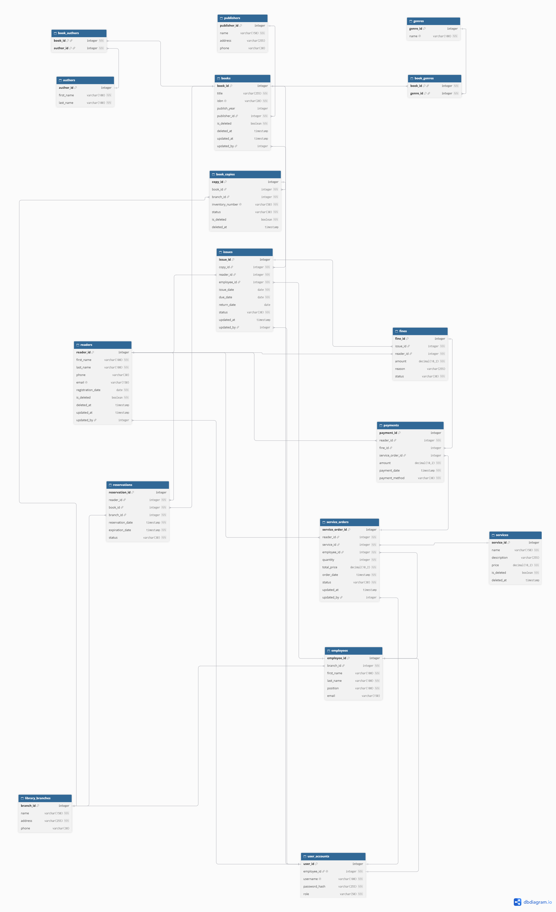
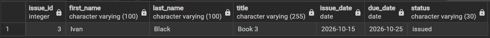
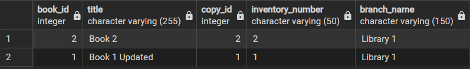
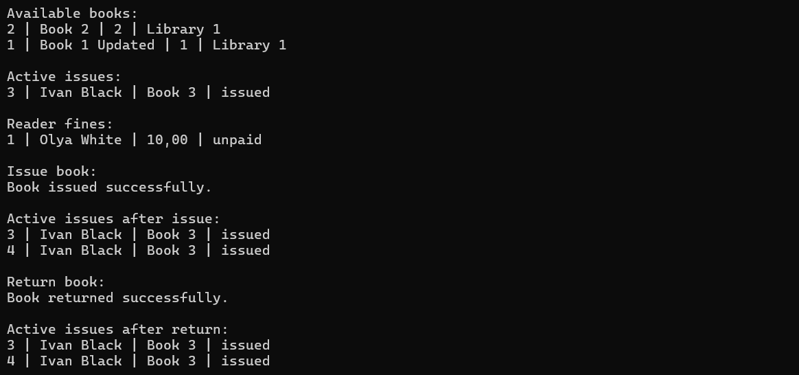
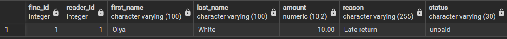
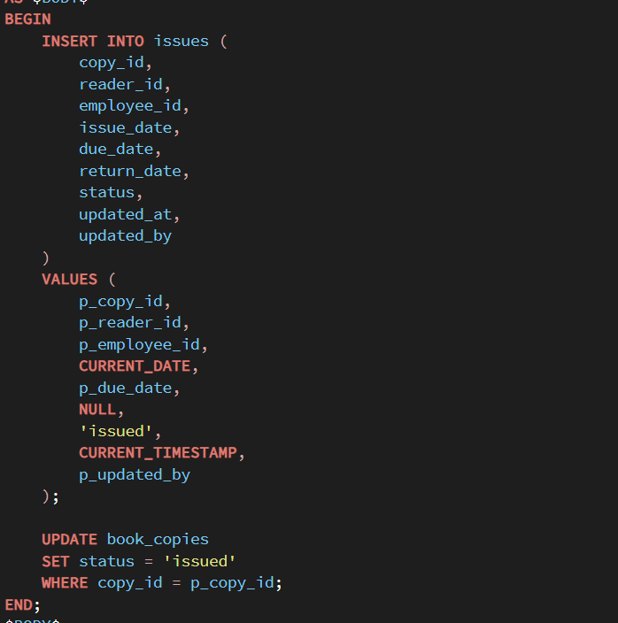
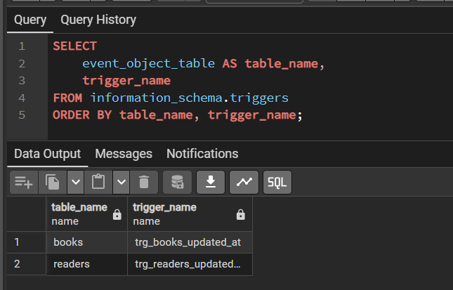
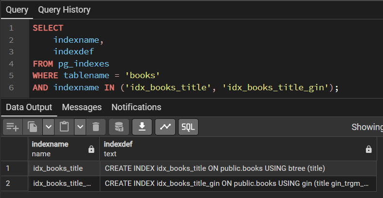

# Система управління бібліотекою з додатковими послугами

## Мета

База даних призначена для роботи бібліотеки. Вона дозволяє зберігати інформацію про книги, авторів, жанри, видавництва, читачів, працівників та філії бібліотеки.

Також у системі можна:
- вести облік окремих примірників книг;
- видавати та повертати книги;
- бронювати книги;
- зберігати інформацію про штрафи та платежі;
- замовляти додаткові послуги бібліотеки;
- зберігати інформацію про останні зміни даних;
- використовувати soft delete для окремих сутностей.

## Технології

- PostgreSQL
- C#
- .NET 8.0
- Npgsql
- Repository Pattern
- Unit of Work

## Основні таблиці

### Книги

- `books` — основна інформація про книги;
- `authors` — автори;
- `genres` — жанри;
- `publishers` — видавництва;
- `book_authors` — зв'язок книг з авторами;
- `book_genres` — зв'язок книг з жанрами;
- `book_copies` — окремі примірники книг.

### Бібліотека

- `library_branches` — філії бібліотеки;
- `employees` — працівники;
- `user_accounts` — облікові записи працівників;
- `readers` — читачі.

### Видача книг

- `issues` — видача та повернення книг;
- `reservations` — бронювання книг;
- `fines` — штрафи читачів;
- `payments` — платежі.

### Додаткові послуги

- `services` — доступні послуги;
- `service_orders` — замовлення послуг.

## Soft Delete та зміни даних

Для таблиць `books`, `book_copies`, `readers` та `services` використовується soft delete через поля:

- `is_deleted`;
- `deleted_at`.

Для частини таблиць також зберігаються:
- `updated_at` — дата останньої зміни;
- `updated_by` — користувач, який зробив зміну.

## View

Створено три View:

- `available_books` — доступні примірники книг;
- `active_issues` — активні видачі;
- `reader_fines` — штрафи читачів.

## Функції

- `get_available_copies` — повертає кількість доступних примірників книги;
- `calculate_fine` — розраховує штраф за прострочення;
- `set_updated_at` — автоматично встановлює дату останньої зміни.

## Процедури

- `issue_book` — створює видачу книги та змінює статус примірника на `issued`;
- `return_book` — повертає книгу та змінює статус примірника на `available`;
- `create_service_order` — створює замовлення додаткової послуги.

## Тригери

- `trg_books_updated_at` — автоматично оновлює `updated_at` при зміні книги;
- `trg_readers_updated_at` — автоматично оновлює `updated_at` при зміні даних читача.

## Індекси

Для таблиці `books` створено два різні типи індексів:

- `BTREE` — для поля `title`;
- `GIN` з `pg_trgm` — для пошуку за назвою книги.

## Робота з C#

## Структура проєкту

| Файл / папка | Вміст |
|---|---|
| `LibraryApp/Models` | моделі даних |
| `LibraryApp/Repositories` | Repository та Unit of Work |
| `LibraryApp/Data` | підключення до PostgreSQL |
| `LibraryApp/Program.cs` | демонстрація роботи програми |
| `database/library.sql` | dump бази даних |
| `database/diagram_library.pgerd` | ER-діаграма |
| `database/diagram_library.png` | схема бази даних |
| `screenshots/` | приклади роботи |

У C# для роботи з базою даних використано Repository Pattern та Unit of Work.

Створені:
- `BookRepository`;
- `IssueRepository`;
- `ReaderFineRepository`;
- `UnitOfWork`.

Дані читаються через створені View, а видача та повернення книг виконуються через збережені процедури PostgreSQL.

## Приклади роботи

### Активні видачі

View `active_issues` показує книги, які зараз видані читачам, дати видачі та повернення, а також статус.

### Доступні книги

View `available_books` показує доступні примірники книг, їхні інвентарні номери та філії бібліотеки.

### Робота програми

У C# реалізувала Repository + Unit of Work. Програма отримує дані через View та викликає процедури PostgreSQL для видачі й повернення книг.

На скріні видно результати запитів, створення нової видачі та повернення книги.

### Штрафи читачів

View `reader_fines` показує штрафи читачів, їхні суми, причини та статус оплати.

### Збережені процедури

Процедура `issue_book` додає запис у таблицю `issues` та змінює статус примірника в `book_copies` на `issued`.

Також створила процедури `return_book` для повернення книги та `create_service_order` для замовлення додаткових послуг.

### Тригери

Тригери `trg_books_updated_at` і `trg_readers_updated_at` автоматично оновлюють поле `updated_at` при зміні даних книги або читача.

### Індекси

Для таблиці `books` створила два типи індексів: `BTREE` для пошуку за назвою та `GIN` з `pg_trgm` для текстового пошуку.

